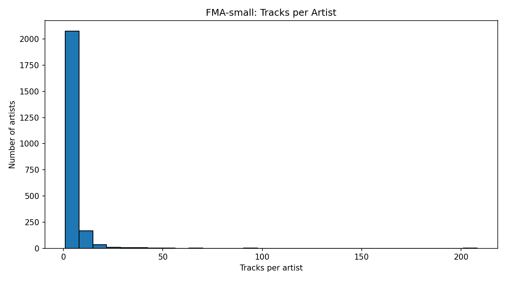

# FMA-small Dataset Audit Report

## Dataset Summary
- Original tracks: 8000
- Duplicate track IDs: 0
- Unique artists: 2309
- Artists appearing in multiple genres: 84
- Removed invalid audio tracks: 6
- Remaining tracks: 7994
- Audio validation: Applied bad_files.csv

## Genre Distribution

| Genre | Track count |
|---|---:|
| Electronic | 1000 |
| Experimental | 1000 |
| Folk | 1000 |
| Hip-Hop | 1000 |
| Instrumental | 1000 |
| International | 1000 |
| Pop | 1000 |
| Rock | 1000 |

## Tracks per Artist
- Mean: 3.46
- Median: 1.00
- Maximum: 208

## Notes
- Official FMA-small split labels were preserved.
- Audio exclusions are applied only when bad_files.csv exists.
- The final clean_tracks.csv schema requires team confirmation.
